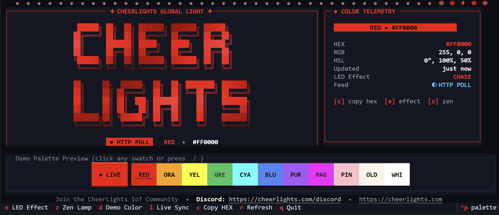

# CheerLights Terminal

A terminal app for [CheerLights](https://cheerlights.com), the global network of synchronized IoT lights. Connects to the CheerLights MQTT broker and ThingSpeak feed to show the current global color, recent history, and color stats.



## Features

- **Live Color Updates**: Subscribes to `mqtt.cheerlights.com` (`cheerlights` and `cheerlightsRGB`) via `paho-mqtt`, with automatic fallback to ThingSpeak HTTP polling if MQTT is unavailable.
- **True-Color Theme & ASCII Banner**: Renders the CheerLights logo using the active hex color with smooth RGB transitions and updates the interface theme automatically.
- **Virtual LED Strip**: Animated status bar with 6 selectable patterns (`breathe`, `chase`, `twinkle`, `wave`, `rainbow`, `solid`) that ripples on color changes.
- **Color Telemetry, History & Stats**: Displays HEX, RGB, and HSL values, connection status (`MQTT LIVE` / `HTTP POLL`), a ribbon and timestamped list of recent changes, and a frequency chart of the last 100 global colors via [`cheerlights-api`](https://pypi.org/project/cheerlights-api/).
- **Zen Mode (`z`)**: Full-screen ambient light view that hides the dashboard panels while staying synced to live updates.
- **Local Demo Preview (`d` / palette bar)**: Preview any of the 11 official CheerLights colors locally without changing the global color, then press `l` to return to live sync.
- **Command Palette (`Ctrl+P`) & Clipboard (`c`)**: Search commands, switch effects, and copy HEX, RGB, or WLED JSON payloads via OSC 52.
- **One-Shot & Intro Animations (`--once` / `--intro`)**: Optional `terminaltexteffects` animations (`beams`, `fireworks`, `slide`, `expand`, `rain`, `spotlights`, `random`) tinted to the active color.

## Install Globally

Requires **Python 3.13+**. Installing as a global tool lets you run `cheerlights` from any directory.

### Option 1: Using `uv` (Recommended)

Install [`uv`](https://docs.astral.sh/uv/getting-started/installation/) if you don't already have it, then install `cheerlights` directly from GitHub:

```bash
uv tool install git+https://github.com/cheerlights/cheerlights-terminal.git
```

Make sure `uv`'s tool bin directory is on your `PATH` (run once, then open a new terminal):

```bash
uv tool update-shell
```

To upgrade later:

```bash
uv tool upgrade cheerlights-terminal
```

Or run it once without installing globally:

```bash
uvx --from git+https://github.com/cheerlights/cheerlights-terminal.git cheerlights
```

### Option 2: Using `pipx`

```bash
pipx install git+https://github.com/cheerlights/cheerlights-terminal.git
```

### Option 3: From a Local Clone

```bash
git clone https://github.com/cheerlights/cheerlights-terminal.git
cd cheerlights-terminal

# Install globally from the local checkout
uv tool install .

# Or install editable so local code edits apply immediately
uv tool install --editable .
```

Once installed, run `cheerlights` from any terminal window:

```bash
cheerlights
```

## Usage

```bash
# Start the full-screen live dashboard
cheerlights

# Play a TerminalTextEffects intro before opening the dashboard
cheerlights --intro
cheerlights --intro --effect fireworks

# Print a one-shot snapshot (optional TTE animation + color telemetry) and exit
cheerlights --once
cheerlights --once --effect none

# Start directly in full-screen Zen mode
cheerlights --zen

# Start in offline local demo mode
cheerlights --demo
cheerlights --demo cyan

# Pick the starting LED pattern or disable MQTT (use HTTP polling only)
cheerlights --led-effect chase
cheerlights --no-mqtt
```

### Keyboard Shortcuts

| Key | Action |
|---|---|
| `e` | Cycle virtual LED strip pattern |
| `z` | Toggle Zen mode (`a` inside Zen toggles the ASCII logo, `Esc` exits) |
| `d` | Cycle through Demo preview colors |
| `l` | Return to live global CheerLights sync |
| `c` | Copy active HEX color to clipboard |
| `r` | Refresh color and history from the API |
| `Ctrl+P` | Open Command Palette (effects, colors, copy HEX/RGB/WLED JSON) |
| `q` | Quit |

## Development

```bash
git clone https://github.com/cheerlights/cheerlights-terminal.git
cd cheerlights-terminal
uv sync

# Run locally inside the project environment
uv run cheerlights

# Run tests (unit tests and headless Textual Pilot tests)
uv run pytest

# Lint and check formatting
uv run ruff check .
uv run ruff format --check .
```

### Project Structure

```text
src/cheerlights_terminal/
├── __init__.py       # Package version
├── main.py           # CLI entry point (argparse)
├── app.py            # Textual application and Command Palette provider
├── styles.tcss       # Textual CSS layout
├── client.py         # Async CheerLights API and paho-mqtt stream client
├── cheerlights.py    # Synchronous helper wrappers
├── colors.py         # Palette helpers, RGB/HSL math, interpolation, contrast
├── ascii_art.py      # True-color ASCII logo renderer
├── intro.py          # TerminalTextEffects intro and --once output
└── widgets/
    ├── hero_banner.py    # Cross-fading ASCII logo widget
    ├── led_strip.py      # Virtual LED strip (6 patterns)
    ├── color_info.py     # Color telemetry panel
    ├── history_panel.py  # Recent color ribbon, timeline, and stats chart
    ├── palette_picker.py # Clickable 11-color demo palette bar
    └── zen_screen.py     # Full-screen Zen mode screen
tests/
├── test_colors.py
├── test_client.py
└── test_app.py
```

## Community

- **Website**: [cheerlights.com](https://cheerlights.com)
- **Discord**: [cheerlights.com/discord](https://cheerlights.com/discord)

## License

See [LICENSE](LICENSE).
